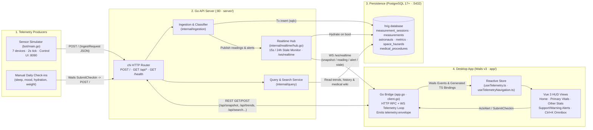

# HRIG System Architecture & Data Flow

This document describes the end-to-end architecture of **HRIG (Resource Integration Gear)** — from simulated biomedical/environmental sensors and manual crew check-ins, through ingestion, PostgreSQL persistence, and WebSocket broadcasting, down to the Wails v3 desktop bridge and Vue 3 clinical HUD.

---

## High-Level Data Flow

---

## Components & Responsibilities

### 1. Shared Domain Contracts ([`shared/model/`](../shared/model/))
Single source of truth for JSON payloads and domain enums shared across `bot/`, `server/`, and `app/`:
- [`model/ingest.go`](../shared/model/ingest.go) — `IngestRequest`, `ReadingInput`, `IngestResult`, `ValueType` (`numeric`, `scale`, `image`), `EnvironmentMode` (`iva`, `eva`).
- [`model/telemetry.go`](../shared/model/telemetry.go) — `Snapshot`, `LatestReading`, `AlertEvent`, `RealtimeEnvelope`, `TrendPoint`, `HistoryEntry`, `SpaceHazard`, `MedicalProcedure`, `SearchResults`, and severity levels (`normal`, `abnormal`, `critical`, `stale`).

### 2. Telemetry Simulator ([`bot/main.go`](../bot/main.go))
Simulates 7 logical hardware devices for the 3-person crew (`Ana Torres`, `Liam Okafor`, `Sofia Petrov`) and posts batched `IngestRequest` payloads to `http://localhost:80/` every `2s`:
- **Astronaut sensors (`Astronaut: true`)**:
  - `biomonitor_01`: `spo2`, `resp_rate`, `heart_rate`, `hrv_rmssd`, `core_temp`
  - `baumanometro_01`: `bp_systolic`, `bp_diastolic`
  - `dosimeter_01`: `radiation_rate`, `radiation_dose_cum`
  - `lab_assay_01`: `blood_glucose`, `rbc_count`, `wbc_count`
  - `ultrasound_01`: `ultrasound` (periodic imaging placeholder)
- **Habitat / Suit sensors (`Astronaut: false`)**:
  - `cabin_sensor_01`: `cabin_o2`, `cabin_ppco2`, `cabin_pressure`, `cabin_temp`
  - `suit_sensor_01`: `suit_pressure`, `suit_temp`
- **Local Control Panel (`127.0.0.1:8090`)**: Serves a dark-HUD web control panel (`GET /`) and JSON endpoints (`POST /override`, `POST /cancel`, `POST /disconnect`, `POST /reconnect`, `GET /status`) to inject `abnormal`/`critical` anomalies or simulate sensor dropouts (`StatusStale`).

> Daily self-reported check-ins (`sleep_hours`, `mood`, `hydration_intake`, `body_mass`) are intentionally excluded from `biomonitor_01` and submitted manually from the UI with `device_code: "manual_checkin"`.

### 3. PostgreSQL Database ([`db/`](../db/))
Local PostgreSQL 17+ instance (`127.0.0.1:5432`, database `hrig`) with schema, seeds, and `sqlc`-generated Go queries (`server/internal/db/`):
- [`001_schema.sql`](../db/001_schema.sql) — `astronauts`, `devices`, `metrics` (with nominal/abnormal/critical thresholds), `units`, `measurement_sessions`, `measurements`, `daily_checkins`, and latest-reading views.
- [`002_seed.sql`](../db/002_seed.sql) & [`003_demo_seed.sql`](../db/003_demo_seed.sql) — Metric catalogs, sensor definitions, crew profiles, and baseline history.
- [`004_medical_manual.sql`](../db/004_medical_manual.sql) — Offline medical knowledge base (`space_hazards` and `medical_procedures` with checklist steps, equipment, and linked `metric_code`s).

### 4. Go API Server ([`server/`](../server/))
Configured via [`internal/config/config.go`](../server/internal/config/config.go) (defaults: `HRIG_API_ADDR=:80`, `HRIG_STALE_AFTER=15s`):
- **HTTP Router ([`internal/http/router.go`](../server/internal/http/router.go))**:
  - `POST /` — Telemetry ingestion endpoint (max 1 MiB JSON body).
  - `GET /ws/realtime` — Live WebSocket feed pushing `RealtimeEnvelope` messages.
  - `GET /api/snapshot` — Current state of all latest readings and active alerts.
  - `POST /api/alerts/{id}/ack` — Acknowledges an active alert in memory and broadcasts update.
  - `GET /api/astronauts`, `GET /api/metrics`, `GET /api/trends`, `GET /api/history` — Historical and time-series queries.
  - `GET /api/hazards`, `GET /api/procedures`, `GET /api/search` — Medical manual and global omnibox search.
  - `GET /health` — Server + PostgreSQL health check and connected WS client count.
- **Ingestion ([`internal/ingestion/`](../server/internal/ingestion/))**: Validates payloads, resolves catalog IDs, writes `measurement_sessions` + `measurements` atomically to PostgreSQL, classifies each reading (`classify.go`) against `metrics` thresholds, and notifies the `Hub`.
- **Realtime Hub ([`internal/realtime/hub.go`](../server/internal/realtime/hub.go))**:
  - Hydrates latest readings from PostgreSQL at startup (`HydrateFromDB`).
  - Tracks active alerts (up to `200` stored) and resolves them automatically when readings return to `normal`.
  - Runs `RunStaleMonitor` every `1s` to flag missing sensor feeds (`15s` for continuous streams, `24h` for daily check-in metrics) as `stale` without polluting PostgreSQL history.

### 5. Wails v3 Desktop Bridge ([`app/`](../app/))
Packages the desktop window (`1280×820`, frameless) in [`app/main.go`](../app/main.go) and bridges backend calls via [`app/app.go`](../app/app.go) & [`app/client.go`](../app/client.go):
- Maintains a resilient WebSocket client (`RunRealtimeLoop` with `1s` → `2s` → `5s` backoff) connected to `<HRIG_API_URL>/ws/realtime`.
- Emits Wails runtime events (`telemetry:envelope`, `telemetry:connection`) directly to the WebView.
- Exposes typed Go methods (`GetSnapshot`, `GetTrends`, `GetHistory`, `AckAlert`, `SubmitCheckin`, `GetHazards`, `GetProcedures`, `SearchAll`, `GetHealth`) compiled into TypeScript bindings under [`app/frontend/bindings/`](../app/frontend/bindings/).

### 6. Vue 3 Clinical HUD ([`app/frontend/src/`](../app/frontend/src/))
- **State & Live Stream ([`composables/useTelemetry.ts`](../app/frontend/src/composables/useTelemetry.ts))**:
  - Hydrates initial crew, metrics, trends, and snapshot on mount, then applies incremental `reading`, `alert`, `alert_ack`, and `stale` WebSocket envelopes.
  - Maintains rolling ring buffers for SVG waveforms, computes pending daily check-in indicators (`hasPendingDailyCheckin`), and exposes `submitCrewDailyMetric` and `acknowledgeAlert`.
- **Alert Navigation & Auto-Recovery ([`composables/useTelemetryNavigation.ts`](../app/frontend/src/composables/useTelemetryNavigation.ts))**:
  - Watches severity transitions and routes to `/support-alert` (`abnormal`) or `/warning-alert` (`critical`) when needed, automatically returning to the previous dashboard view once all readings stabilize.
- **Views ([`views/`](../app/frontend/src/views/))**:
  - `/` (`HomeView.vue`) — Crew overview cards, Environment card, Medical Manual link, and global `Ctrl+K` trigger.
  - `/dashboard-principal` (`dashboard-principal.vue`) — Primary Vitals HUD with live sparklines, `?` procedure shortcuts, crew switcher, and reactive anatomical wireframe (`body-alert-warn` / `body-alert-crit`).
  - `/other-stats` (`dashboard-secundario.vue`) — Secondary continuous waveforms plus inline Periodic & Daily Check-in logging (`sleep_hours`, `mood`, `hydration_intake`, `body_mass`, labs, imaging).
  - `/support-alert` & `/warning-alert` (`support-alert.vue`, `warning-alert.vue`) — Guided caution and critical emergency action views.
  - `/search` (`SearchView.vue`) — Reka UI `Ctrl+K` Omnibox across Crew (with all-crew live metric readouts), Medical Procedures (with inline step-by-step checklists), and Space Hazards & Metrics.

---

## End-to-End Event Sequences

1. **Live Telemetry Tick (`~2s` cadence)**  
   `bot/main.go` posts `IngestRequest` → `server` persists rows to PostgreSQL & evaluates thresholds → `Hub` broadcasts `reading` (and `alert` if `abnormal`/`critical`) via `/ws/realtime` → `app/client.go` emits `telemetry:envelope` → `useTelemetry.ts` updates cards, waveforms, and anatomical wireframe highlights.
2. **Sensor Dropout (`>15s` without update)**  
   `Hub.RunStaleMonitor` detects expired `RecordedAtUTC` → marks reading `stale` in memory and broadcasts `stale` envelope → Primary/Other Stats cards display dashed border + `"Sensor Disconnected · No Signal"`.
3. **Manual Daily Check-In**  
   Astronaut logs sleep/mood/hydration/weight in `/other-stats` → Vue calls `submitCrewDailyMetric` → Wails `SubmitCheckin` sends `POST /` (`device_code: "manual_checkin"`) → `server` stores in PostgreSQL & broadcasts via `Hub` → pending yellow dot clears on `Home` & `Other Stats`.
4. **Medical Manual / Omnibox Lookup (`Ctrl+K`)**  
   User searches `"eye"` or `"oxygen"` in `SearchView.vue` → Wails `SearchAll` queries `GET /api/search` against `space_hazards`, `medical_procedures`, and `astronauts` → renders inline checklists or live per-member metric comparisons.

---

## System Deployment Description

The diagram models HRIG's physical and logical deployment, distinguishing the hardware currently available from the Earth-transmission infrastructure, whose specific standard is still to be determined.

### Devices (`«device»`)

- **Laptop (Spacecraft):** physical equipment aboard the spacecraft/habitat where the entire HRIG application runs during the mission.
- **Smartwatch:** real wearable device that collects the astronaut's health data and sends it to the server via HTTP/HTTPS.
- **NASA Mission Control Center (Earth):** external node on Earth that receives and processes the records synced from the spacecraft.

### Execution Environments (`«executionEnvironment»`)

- **Windows/Linux:** operating system on which the HRIG desktop application runs inside the Laptop.
- **PostgreSQL Container:** execution environment hosting the local `HRIG Database`.

### Main Components

- **HRIG Desktop Application:** application package that bundles the graphical interface and, optionally, a sensor simulator for testing.
  - *Sensor Simulator (optional):* component used only for demos or testing when no physical device (smartwatch) is available; it is not part of the production flow.
  - *Vue 3 / Wails Graphical Interface:* clinical interface the astronaut uses to view their vital signs and log manual check-ins.
- **Go API Server:** the application's central backend. It receives health data (from the smartwatch or the simulator) over HTTP/HTTPS, persists it to PostgreSQL, serves the interface via local communication, and hands off pending records to the sync module.
- **Ground Sync Module:** component responsible for preparing and transmitting accumulated records to Earth, using the appropriate space protocol. It operates asynchronously relative to the rest of the system.
- **HRIG Database:** local PostgreSQL database with two logical tables:
  - *Records Pending Transmission:* records not yet confirmed as received by Mission Control.
  - *Health Measurements:* historical record of the crew's health measurements.
- **Data Reception and Processing:** component at NASA's Mission Control Center responsible for receiving and processing the data transmitted from the spacecraft.

### Communications

- **Local Communication:** internal channel between the graphical interface and the Go API Server within the same process/machine.
- **«HTTP/HTTPS» Health Data:** channel through which the Smartwatch sends health data to the Go API Server.
- **«PostgreSQL Protocol» Read and Write:** persistence channel between the Go API Server and the database.
- **Records for Transmission:** internal flow of records from the Go API Server to the Ground Sync Module.
- **«CCSDS» Standard TBD (Space Packet / CFDP):** space communication link between the Ground Sync Module and Mission Control on Earth. The specific standard within the CCSDS family (e.g., Space Packet Protocol or CFDP) will be defined based on the communication infrastructure actually available at mission time.

### Operational Considerations

- **Offline operation:** HRIG continues to function normally even without a link to Earth; records accumulate locally and are transmitted as soon as the link is restored (store-and-forward pattern).
- **Local storage:** all measurements and records pending transmission are kept in the local database, ensuring no data is lost during communication outages.
- **CCSDS standard selection pending:** which variant of the CCSDS standard will be used is deliberately left open, since it depends on the actual space link infrastructure available, and is not a decision that falls within the scope of the current prototype.
