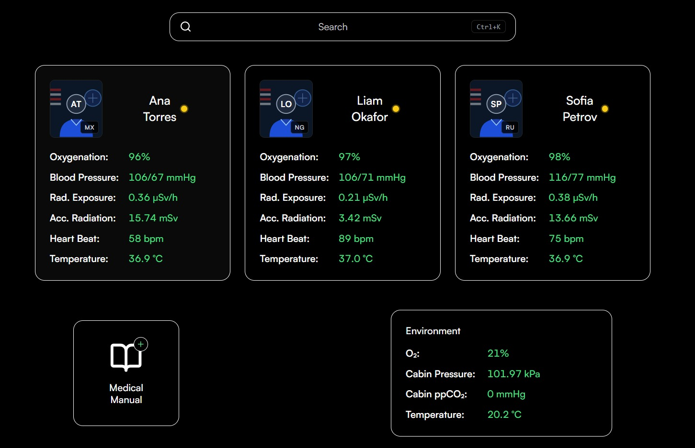
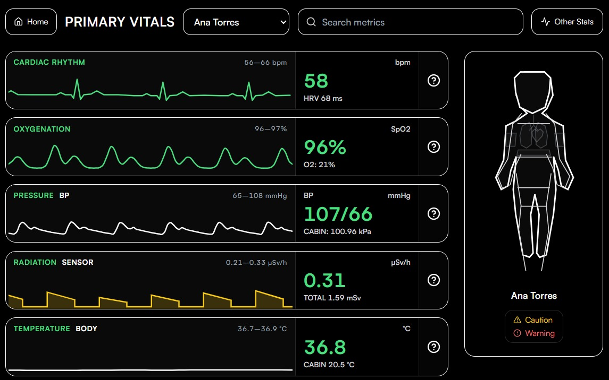
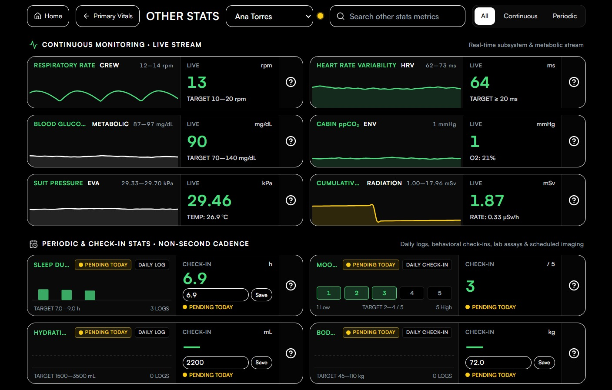
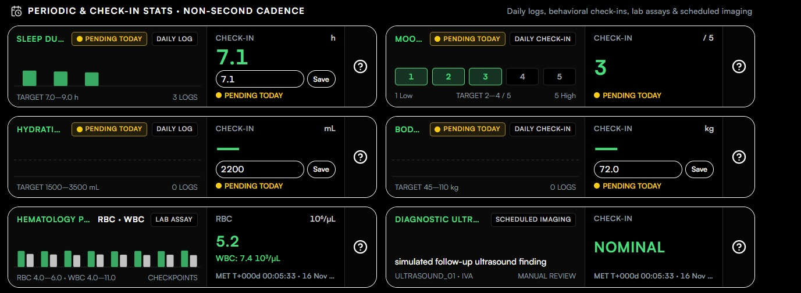
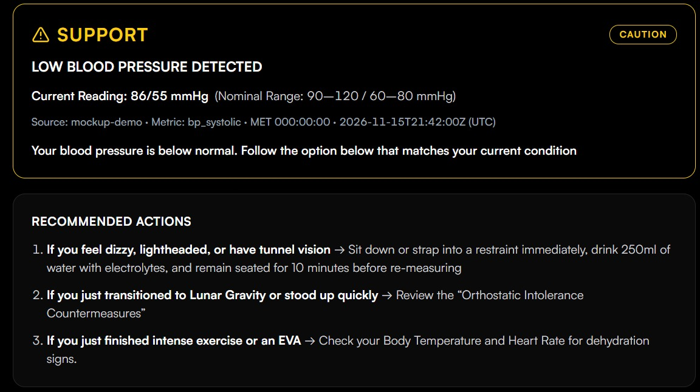
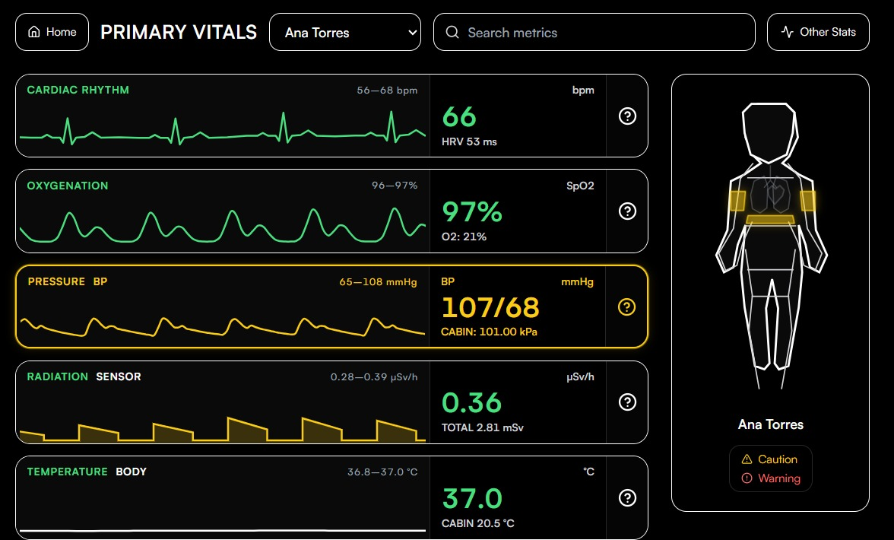
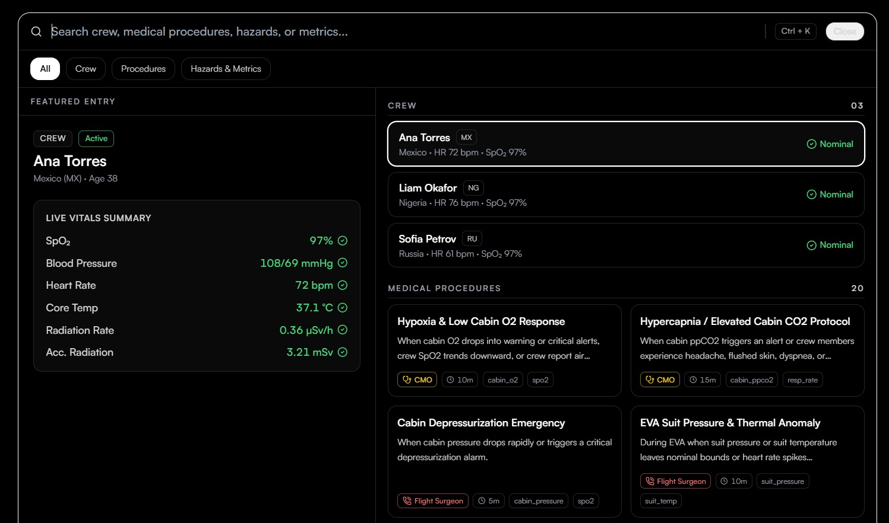
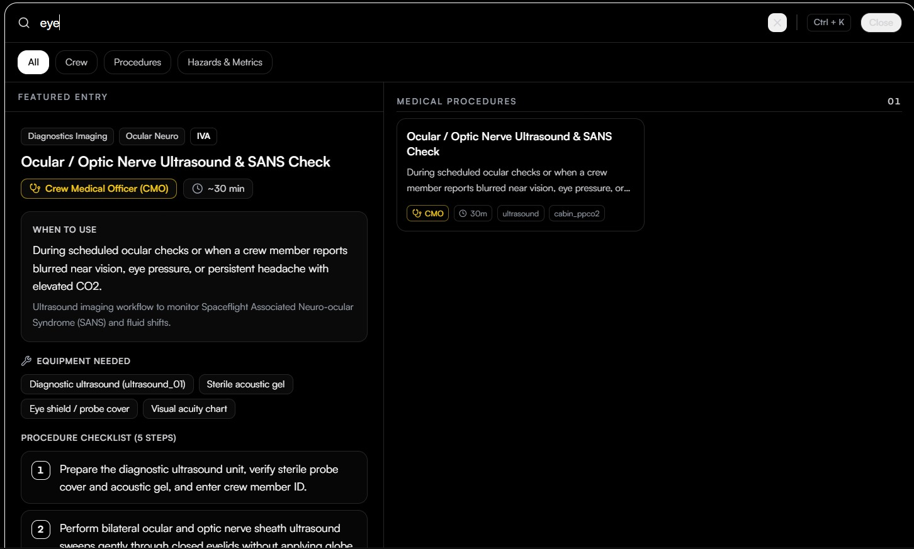

# HRIG — Health Resource Integration Gear

**Resource Integration Gear (HRIG)** is a NASA hackathon project for building visual, self-assessment health monitoring software for astronauts on long-duration space missions.

Inspired by the **RIG** concept from *Dead Space*—an at-a-glance, body-integrated health and status system—this project adapts that core idea into a pragmatic, calm, clinical software prototype achievable within a 2-day hackathon using current technology.

## Download & Run (Final Build)

A ready-to-run build is available on Google Drive: **[Download HRIG](https://drive.google.com/drive/folders/1KA3qHV0NSGztI8T6moCz_jxkgiJuYPOj?usp=sharing)**

1. Download the ZIP from the Drive folder and unzip it (a short path such as `C:\HRIG` works best).
2. Double-click **`Start-HRIG.bat`**.
3. Wait for the HRIG window to open. The first launch can take 1–2 minutes while the local database is created; later launches are much faster.
4. Close the HRIG window to stop everything.

Everything is bundled (database, API server, sensor simulator, and desktop app), so nothing needs to be installed and no admin rights are required.

> **Platform support:** this build runs on **Windows 10/11 (64-bit) only** for now (the Microsoft Edge WebView2 Runtime is required and comes preinstalled on Windows 11). macOS and Linux packages are planned.
> **Windows SmartScreen:** the files are unsigned, so Windows may warn on first launch. Click *More info* → *Run anyway*.

See `README-JUDGES.md` inside the ZIP for the sensor simulator control panel and troubleshooting.

## Challenge & Objective

Long-duration missions expose crews to NASA's five hazards of human spaceflight (**Space Radiation**, **Isolation and Confinement**, **Distance from Earth**, **Gravity Fields**, and **Hostile/Closed Environments**).

Resource Integration Gear provides an offline-first interface that gathers key health indicators, visualizes status clearly (including an interactive anatomical figure), and gives non-physician astronauts actionable guidance to prevent and respond to health risks.

## Interface Showcase

### Crew Overview & Environment
At-a-glance status for every crew member, cabin environment telemetry, quick access to the Medical Manual, and the global `Ctrl+K` Omnibox.

### Primary Vitals HUD
Real-time waveforms for cardiac rhythm, oxygenation, blood pressure, radiation exposure, and body temperature paired with an interactive anatomical wireframe.

### Other Stats & Periodic Daily Check-ins
Secondary continuous streams (respiratory rate, HRV, blood glucose, cabin ppCO2, EVA suit pressure, cumulative radiation) alongside daily crew check-ins, lab assays, and imaging logs.

### Caution / Support Alerts & Anatomical Highlighting
Abnormal readings surface clear, actionable medical guidance and highlight affected telemetry cards and body regions directly on the Primary Vitals HUD.

### Medical & Crew Omnibox (`Ctrl+K`)
Keyboard-first search across crew vitals, spaceflight hazards, metrics, and offline medical procedure checklists.

## Why This Stack

- **Go Everywhere (API Server, Simulator, Shared Contracts & App Bridge):** Lightweight, easy to work with, robust (Google-backed), and highly portable—every backend component compiles down to self-contained native binaries and shares the exact same typed domain models (`shared/model/`).
- **Wails v3 (Desktop Shell):** Keeps **complete data safety** end-to-end by pairing Go directly with auto-generated TypeScript bindings, integrates seamlessly without shipping a heavy bundled Chromium runtime (using the OS WebView instead), and stays compact enough for constrained mission environments.
- **Web Stack — Vue 3, TypeScript, Vite & UnoCSS (UI):** Fast to iterate on and widely understood, making it ideal for crafting a calm, responsive clinical HUD, custom SVG waveforms, and keyboard-first medical workflows.
- **PostgreSQL → Planned Migration to Embedded libSQL:** PostgreSQL gives us a rock-solid, open-source relational store for time-series telemetry, thresholds, and medical catalogs. However, because it runs as an external server rather than an embedded engine, it is currently our biggest portability bottleneck—**the bundled demo only runs on Windows** due to packaging the local PostgreSQL binaries. Migrating to an embeddable database like **libSQL** removes that external dependency so the entire app runs natively on **any platform (Windows, macOS, Linux)** while storing telemetry locally and **syncing back to Houston** whenever a link is available.

See [`.routing/ARCHITECTURE.md`](.routing/ARCHITECTURE.md) for the full component & data-flow diagram.

## Repository Navigation

### Core Project Docs
- [`PROJECT-REVIEW.md`](PROJECT-REVIEW.md) — Scope & feasibility audit (`venture-killer`) with proposed MVP cuts *(pending team review)*.
- [`docs/METRICS_PRIORIZATION.md`](docs/METRICS_PRIORIZATION.md) — Health metric hierarchy (Primary HUD, Secondary Trends, Excluded) and NASA references.
- [`docs/STACK_SETUP.md`](docs/STACK_SETUP.md) — Full-stack installation & development guide (Wails v3 desktop/UI, Go API, PostgreSQL 17+).
- [`db/README.md`](db/README.md) — PostgreSQL schema (`001_schema.sql`), catalog seeds (`002_seed.sql`), and 3-day demo dataset (`003_demo_seed.sql`).

### Planning & Ground Rules (`.routing/`)
- [`.routing/ARCHITECTURE.md`](.routing/ARCHITECTURE.md) — End-to-end system architecture and data flow (sensors, Go server, PostgreSQL, Wails v3, Vue 3 HUD).
- [`.routing/PROGRESS.md`](.routing/PROGRESS.md) — Current tasks, completed milestones, and upcoming work.
- [`.routing/CONTEXT.md`](.routing/CONTEXT.md) — Ground rules (Conventional Commits in English) and file map.
- [`.routing/SPECIFICATION.md`](.routing/SPECIFICATION.md) — Functional (`RF`) and non-functional (`RNF`) requirements *(maintained in Spanish until final delivery)*.
- [`.routing/DOMAIN.md`](.routing/DOMAIN.md) — Ubiquitous Language glossary for metrics, severity states, crew roles, and anatomy.
- [`.routing/DESIGN.md`](.routing/DESIGN.md) — UI/UX guidelines, status color/icon redundancy, and human-factors references.
- [`.routing/BD.md`](.routing/BD.md) — PostgreSQL database design specification (tables, constraints, triggers, seed units/metrics).
- [`.routing/BDML.md`](.routing/BDML.md) — DBML schema representation generated from `.routing/BD.md`.
- [`.routing/INPUT.md`](.routing/INPUT.md) — Original NASA hackathon challenge brief and radiation monitoring notes.
- [`.routing/reference/`](.routing/reference/) — Quick reference notes on each of NASA's five hazards of human spaceflight.

### Agent Workflow Skills (`.claude/skills/`)
- [`router`](.claude/skills/router/SKILL.md) — Project coordination, grounding, and ticket dispatch workflow.
- [`ticket`](.claude/skills/ticket/SKILL.md) — Specification format for `.tickets/` tasks and binary verification checks.
- [`venture-killer`](.claude/skills/venture-killer/SKILL.md) — Scope creep and feasibility audit rules.

## NEXT STEPS 

- Add menstrual cycle tracking
- Test in real-world scenarios
- Incorporate real measurement devices
- Implement a metric translation system to facilitate the integration of additional measurement devices.
