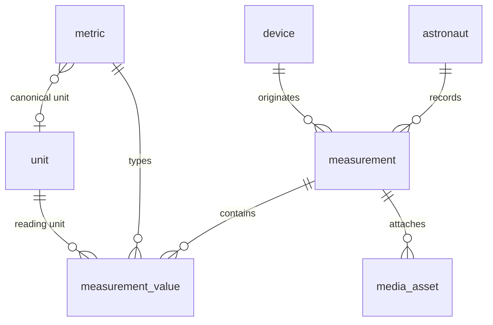

# bd.md — Astronaut Profiles and Measurements

> **Status:** specification for review. No SQL has been generated and nothing exists in the database yet.
> **Scope:** only the **astronaut profile** and the **measurements with their unit of measure**.
> **Out of scope:** mission, physical location, clinical threshold configuration, alerts, symptoms, procedures, users, and audit.

## Conventions

- `snake_case` identifiers in English; all document content in English.
- `uuid` primary keys on every table.
- Physical values as `numeric(12,4)` (never `float`).
- Dates as `timestamptz` in UTC.
- The unit is **never** free text: always a FK to `unit`.
- Logical deletion with `is_active` on catalogs; clinical data is never deleted.

---

## 1. `astronaut` — crew profile

| Attribute | Type | Constraint |
|---|---|---|
| `id` | uuid | PK |
| `full_name` | text | NOT NULL, `length(trim(full_name))` 1–120 |
| `birth_date` | date | NOT NULL, `<= CURRENT_DATE` |
| `age` | smallint | **derived**, not stored |
| `nationality_code` | char(2) | NOT NULL, `CHECK (nationality_code ~ '^[A-Z]{2}$')` |
| `nationality_label` | text | nullable |
| `is_active` | boolean | NOT NULL, default `true` |
| `created_at` | timestamptz | NOT NULL, default `now()` |
| `updated_at` | timestamptz | NOT NULL, default `now()` |

> The requested profile (`name, age, nationality, date of birth`) is covered: `age` is derived from `birth_date` so it never goes stale. `nationality_label` is display-only; the UI falls back to `nationality_code` when it is `NULL`.

## 2. `unit` — unit of measure

| Attribute | Type | Constraint |
|---|---|---|
| `id` | uuid | PK |
| `code` | text | UNIQUE, NOT NULL |
| `symbol` | text | NOT NULL |
| `dimension` | text | NOT NULL |
| `decimals` | smallint | default `1` |
| `is_active` | boolean | NOT NULL, default `true` |

> **`code`** is a UCUM code: `%`, `mm[Hg]`, `kPa`, `/min`, `ms`, `Cel`, `uSv/h`, `mSv`, `mg/dL`, `kg`, `h`, `mL`, `10*6/uL`, `10*3/uL`, `{score}`.
> **`symbol`** is the display text: `mmHg`, `°C`, `bpm`.
> **`dimension`** groups comparable units: `fraction`, `pressure`, `temperature`, `rate`, `time`, `dose`, `dose_rate`, `concentration`, `mass`, `volume`, `count`, `score`.
>
> **Requirement example:** "heart rate = 10" is stored as `value_numeric = 10` with `unit_id = bpm`. The unit always travels with the value, so changing the unit a device reports never rewrites historical readings.

## 3. `metric` — measurement type catalog

| Attribute | Type | Constraint |
|---|---|---|
| `id` | uuid | PK |
| `code` | text | UNIQUE, NOT NULL |
| `name` | text | NOT NULL |
| `short_name` | text | nullable |
| `category` | text | NOT NULL |
| `tier` | enum `metric_tier` | NOT NULL |
| `metric_type` | smallint | NOT NULL, `CHECK (metric_type IN (1, 2))` |
| `value_type` | enum `value_type` | NOT NULL |
| `base_unit_id` | uuid | FK → `unit`, nullable |
| `display_unit_symbol` | text | nullable |
| `scale_min` | smallint | nullable |
| `scale_max` | smallint | nullable |
| `display_order` | smallint | default `0` |
| `is_active` | boolean | NOT NULL, default `true` |

> **`metric_type`:** `1` = astronaut measurement (physiological), `2` = environmental measurement (cabin or suit). `measurement.astronaut_id` must be `NULL` when `metric_type = 2` (cross-table rule, enforced by trigger `trg_measurement_metric_type`).
> **`category`:** `oxygenation`, `pressure`, `radiation`, `cardiac`, `temperature`, `sleep_mood`, `metabolic`, `hydration_body`, `lab_imaging`.
> **`value_type`** decides which column of `measurement_value` carries the data: `numeric` → `value_numeric`, `scale` → `value_scale`, `text` → `value_text`, `image` → `value_text` plus `media_asset`.
> **`base_unit_id`** is the canonical unit, present only for `numeric` and `scale` metrics.
> **`display_unit_symbol`** overrides `unit.symbol` in the HUD when one unit is shared by several metrics (`/min` is `bpm` for `heart_rate` but `rpm` for `resp_rate`). When `NULL`, `unit.symbol` is used.
> **`scale_min` / `scale_max`** apply only to `value_type = 'scale'` (mood 1–5).

**Constraints**

- `CHECK (value_type <> 'scale' OR (scale_min IS NOT NULL AND scale_max IS NOT NULL))`
- `CHECK (scale_min IS NULL OR scale_max IS NULL OR scale_min < scale_max)`
- `CHECK (value_type NOT IN ('numeric','scale') OR base_unit_id IS NOT NULL)`
- `CHECK (value_type NOT IN ('text','image') OR base_unit_id IS NULL)`

## 4. `device` — device that originates the reading

| Attribute | Type | Constraint |
|---|---|---|
| `id` | uuid | PK |
| `code` | text | UNIQUE, NOT NULL |
| `name` | text | NOT NULL |
| `kind` | enum `device_kind` | NOT NULL |
| `is_active` | boolean | NOT NULL, default `true` |

> **`code`** examples: `biomonitor_01`, `dosimeter_01`, `suit_bus_02`.
> **`kind`:** `wearable`, `environment_sensor`, `manual`, `lab_assay`, `imaging`.

## 5. `metric_threshold` — classification limits

| Attribute | Type | Meaning |
|---|---|---|
| `id` | uuid | PK |
| `metric_id` | uuid | UNIQUE FK → `metric`; at most one threshold row per metric |
| `warning_min`, `warning_max` | numeric(12,4) | Warning boundaries in the metric's canonical unit |
| `critical_min`, `critical_max` | numeric(12,4) | Critical boundaries in the metric's canonical unit |
| `classification_mode` | text | `numeric` for range evaluation; `manual` for human-reviewed metrics such as images |
| `source` | text | Provenance/review note for these limits |
| `updated_at` | timestamptz | Time of last update |

Every metric in the catalog has a configuration from `002_seed.sql`. For `numeric` mode, the server checks critical limits first: a value at/beyond a configured critical boundary is `critical`; otherwise a value beyond a warning boundary is `abnormal`; values within the warning boundaries are `normal`. A `NULL` boundary means no limit on that side. `manual` mode is used for image metrics such as ultrasound, whose finding must be classified by a human rather than assigned a fabricated numeric range. The mockup boundaries approximate common adult resting references for vital signs and sleep; spacecraft, EVA, lab, and individual thresholds remain illustrative and require domain review. They are mockup values, not medical advice. The heart-rate example marks values at or above 200 bpm as critical.

## 6. `measurement` — capture event or session

| Attribute | Type | Constraint |
|---|---|---|
| `id` | uuid | PK |
| `astronaut_id` | uuid | FK → `astronaut`, nullable |
| `device_id` | uuid | FK → `device`, nullable |
| `environment` | enum `environment_mode` | NOT NULL |
| `recorded_at_utc` | timestamptz | NOT NULL |
| `note` | text | nullable |

> One session groups every value captured together: a blood pressure reading is one `measurement` with two `measurement_value` rows. `astronaut_id` is `NULL` for cabin/suit readings (O2, pressure, ambient temperature); `device_id` is `NULL` when the data is entered manually. `note` holds context such as `post-EVA` or `resting`.

**Constraints**

- `CHECK (num_nonnulls(astronaut_id, device_id) >= 1)` — a session belongs to a person or to a device.

**Indexes:** `(astronaut_id, recorded_at_utc DESC)` · `(device_id, recorded_at_utc DESC)`

## 7. `measurement_value` — individual reading value

| Attribute | Type | Constraint |
|---|---|---|
| `id` | uuid | PK |
| `measurement_id` | uuid | FK → `measurement`, NOT NULL, ON DELETE RESTRICT |
| `metric_id` | uuid | FK → `metric`, NOT NULL |
| `unit_id` | uuid | FK → `unit`, nullable |
| `recorded_at_utc` | timestamptz | NOT NULL, copied from `measurement` |
| `value_numeric` | numeric(12,4) | nullable |
| `value_scale` | smallint | nullable |
| `value_text` | text | nullable |
| `status` | enum `reading_status` | NOT NULL, default `normal` |
| `note` | text | nullable |

> `unit_id` is the **actual** unit this reading arrived in, and it is required whenever `value_numeric` is present. It stays `NULL` only for `text` and `image` metrics. `value_scale` holds subjective scales (mood 1–5); `value_text` holds findings and interpretations.
> `recorded_at_utc` is the **only** denormalized field in the schema. It always mirrors `measurement.recorded_at_utc` (enforced by trigger `trg_measurement_value_timestamp`) and exists so the HUD can answer "latest value per metric" with a single index scan instead of sorting the history of every metric.
> `status` stores the classification for this individual reading: `normal`, `abnormal` (review/check recommended) or `critical` (urgent response). The server determines it from `metric_threshold` and stores the resulting status with the reading.

**Constraints**

- `UNIQUE (measurement_id, metric_id)`
- `CHECK (num_nonnulls(value_numeric, value_scale, value_text) >= 1)`
- `CHECK (value_numeric IS NULL OR unit_id IS NOT NULL)`
- `unit_id` must share `dimension` with `metric.base_unit_id` (trigger `trg_measurement_value_dimension`, since a `CHECK` cannot read other tables)

**Index:** `(metric_id, recorded_at_utc DESC)` — serves both the latest-value lookup and 24-hour trends.

## 8. `media_asset` — ultrasound image

| Attribute | Type | Constraint |
|---|---|---|
| `id` | uuid | PK |
| `measurement_id` | uuid | FK → `measurement`, NOT NULL |
| `kind` | enum `media_kind` | NOT NULL |
| `file_path` | text | NOT NULL |
| `mime_type` | text | NOT NULL |
| `findings` | text | nullable |
| `captured_at_utc` | timestamptz | nullable |

> **`file_path`** is relative to the project root, e.g. `media/ultrasound/2026-11-15_crew01.jpg`.
> **`captured_at_utc`** may be `NULL`; when missing, the UI uses `measurement.recorded_at_utc`.

**Constraint**

- `CHECK (mime_type IN ('image/jpeg','image/png','application/pdf'))`

---

## Enumerated types

```sql
CREATE TYPE metric_tier      AS ENUM ('primary', 'secondary');
CREATE TYPE value_type       AS ENUM ('numeric', 'scale', 'text', 'image');
CREATE TYPE environment_mode AS ENUM ('iva', 'eva');
CREATE TYPE device_kind      AS ENUM ('wearable', 'environment_sensor', 'manual', 'lab_assay', 'imaging');
CREATE TYPE media_kind       AS ENUM ('ultrasound', 'ocular');
```

## Relationships



| Relationship | Cardinality | Note |
|---|---|---|
| `astronaut` → `measurement` | 1 : N (0..N) | `astronaut_id` is `NULL` for environmental readings (`metric_type = 2`) |
| `device` → `measurement` | 1 : N (0..N) | `NULL` when captured manually |
| `measurement` → `measurement_value` | 1 : N | A blood pressure reading is 2 values in the same event |
| `metric` → `measurement_value` | 1 : N | — |
| `metric` → `metric_threshold` | 1 : 0..1 | Limits consulted by the server when classifying readings |
| `metric` → `unit` | N : 1 (0..1) | Canonical unit of the measurement type |
| `unit` → `measurement_value` | 1 : N | Actual unit the value arrived in |
| `measurement` → `media_asset` | 1 : N (0..N) | Only studies with an image |
| `astronaut.age` | derived | Computed from `birth_date`, never stored |
| `metric.metric_type` | 1 or 2 | `1` = astronaut (physiological), `2` = environmental (cabin/suit) |

---

## Initial metric catalog

### 1. Primary Metrics (Main HUD, always visible)

| code | name | category | tier | metric_type | canonical unit |
|---|---|---|---|---|---|
| `spo2` | Blood oxygen saturation | oxygenation | primary | 1 | `%` |
| `cabin_o2` | Cabin O2 | oxygenation | primary | 2 | `%` |
| `cabin_ppco2` | Cabin ppCO2 | oxygenation | primary | 2 | `mm[Hg]` |
| `resp_rate` | Respiratory rate | oxygenation | primary | 1 | `/min` |
| `cabin_pressure` | Cabin pressure | pressure | primary | 2 | `kPa` |
| `suit_pressure` | Suit pressure | pressure | primary | 2 | `kPa` |
| `bp_systolic` | Systolic blood pressure | pressure | primary | 1 | `mm[Hg]` |
| `bp_diastolic` | Diastolic blood pressure | pressure | primary | 1 | `mm[Hg]` |
| `radiation_rate` | Exposure rate | radiation | primary | 1 | `uSv/h` |
| `radiation_dose_cum` | Cumulative dose | radiation | primary | 1 | `mSv` |
| `heart_rate` | Heart rate | cardiac | primary | 1 | `/min` |
| `hrv_rmssd` | Heart rate variability (RMSSD) | cardiac | primary | 1 | `ms` |
| `core_temp` | Core body temperature | temperature | primary | 1 | `Cel` |
| `cabin_temp` | Cabin temperature | temperature | primary | 2 | `Cel` |
| `suit_temp` | Suit temperature | temperature | primary | 2 | `Cel` |

### 2. Secondary Metrics (trends and scheduled check-ins)

| code | name | category | tier | metric_type | canonical unit |
|---|---|---|---|---|---|
| `sleep_hours` | Sleep hours | sleep_mood | secondary | 1 | `h` |
| `mood` | Mood (1–5) | sleep_mood | secondary | 1 | `{score}` |
| `blood_glucose` | Blood glucose | metabolic | secondary | 1 | `mg/dL` |
| `hydration_intake` | Fluid intake | hydration_body | secondary | 1 | `mL` |
| `body_mass` | Body mass | hydration_body | secondary | 1 | `kg` |
| `rbc_count` | Red blood cell count | lab_imaging | secondary | 1 | `10*6/uL` |
| `wbc_count` | White blood cell count | lab_imaging | secondary | 1 | `10*3/uL` |
| `ultrasound` | Diagnostic ultrasound | lab_imaging | secondary | 1 | `NULL` (`value_type = image`) |

> `mood` is stored with `value_type = 'scale'`, `scale_min = 1`, `scale_max = 5`.
> `ultrasound` uses `value_type = 'image'`: `value_text` for the finding and `media_asset` for the file.

---

## Seed units

| code | symbol | dimension | decimals |
|---|---|---|---|
| `%` | % | fraction | 0 |
| `mm[Hg]` | mmHg | pressure | 0 |
| `kPa` | kPa | pressure | 2 |
| `/min` | rpm | rate | 0 |
| `ms` | ms | time | 0 |
| `Cel` | °C | temperature | 1 |
| `uSv/h` | µSv/h | dose_rate | 2 |
| `mSv` | mSv | dose | 2 |
| `mg/dL` | mg/dL | concentration | 0 |
| `kg` | kg | mass | 1 |
| `h` | h | time | 1 |
| `mL` | mL | volume | 0 |
| `10*6/uL` | 10⁶/µL | count | 1 |
| `10*3/uL` | 10³/µL | count | 1 |
| `{score}` | — | score | 0 |

## Design decisions

| ID | Decision | Rationale |
|---|---|---|
| D1 | Metrics live in the `metric` catalog, not in fixed columns | Add or remove metrics without a schema migration |
| D2 | The event (`measurement`) is separated from the value (`measurement_value`) | Blood pressure, blood panel, or sleep+mood share one timestamp and one device |
| D3 | Age is not stored | Derived from `birth_date` so it never goes stale |
| D4 | Every reading stores the unit it arrived in | Switching units never rewrites history. Normalization to `metric.base_unit_id` is an application concern; the schema stores raw values only |
| D5 | Blood pressure = 2 rows (`bp_systolic`, `bp_diastolic`) | Enables per-component trends with no special columns |
| D6 | Blood panel = 1 row per analyte | Hemoglobin or any future analyte is a new catalog row |
| D7 | Only profile + measurements are stored | No mission, location, thresholds, or alerts in this database |
| D8 | `metric_type` is a smallint (`1` astronaut, `2` environmental) instead of an enum | It is a fixed two-way classification used for filtering, not an open set |
| D9 | No description column on any table | Documentation lives in this file; the schema keeps only data and constraints |
| D10 | `measurement_value.recorded_at_utc` is denormalized | Measured: 169 ms → 0.34 ms on the HUD and 410 ms → 40 ms on 24-hour trends at 50k readings. It is the only duplicated field and a trigger keeps it in sync |
| D11 | Unit dimension is enforced by trigger, not by agreement | Measured: `heart_rate = 70` with `unit = kg` was accepted without it; a `CHECK` cannot compare two tables |
| D12 | Reading status is stored per measurement value and limits are data | The server consults `metric_threshold`, then stores normal, abnormal, or critical on the reading |

## Implementation notes

- **Target engine:** PostgreSQL 18. No `serial`; all primary keys are `uuid`.
- **UUID generation:** `gen_random_uuid()` (built into PostgreSQL 13+) as the column default on every `id`.
- **`v_astronaut_age`:** completed years between `birth_date` and `CURRENT_DATE`, subtracting 1 when this year's birthday has not occurred yet.

  ```sql
  CREATE VIEW v_astronaut_age AS
  SELECT id,
         date_part('year', age(CURRENT_DATE, birth_date))::smallint AS age
  FROM astronaut;
  ```

- **Normalization:** `measurement_value.value_numeric` keeps exactly the number the device reported, paired with `unit_id`. Converting to `metric.base_unit_id` happens in the application layer; this schema stores raw values only and has no conversion table.
- **`astronaut.updated_at`:** maintained by a `BEFORE UPDATE` trigger (`trg_astronaut_updated_at`); the `DEFAULT now()` covers inserts only.
- **Seeds are idempotent:** `unit`, `metric` and `device` are seeded with `INSERT ... ON CONFLICT (code) DO UPDATE`, so re-running the seed never duplicates rows. Foreign keys in seeds are resolved by `code`, never by hardcoded `uuid`.
- **Session ownership:** `measurement` requires at least one of `astronaut_id` or `device_id` (`CHECK (num_nonnulls(astronaut_id, device_id) >= 1)`), and `astronaut_id` must be `NULL` when the metric is environmental (`metric_type = 2`). The second rule crosses tables, so it lives in trigger `trg_measurement_metric_type` rather than a `CHECK`.
- **`media_asset.file_path`:** relative to the project root, e.g. `media/ultrasound/2026-11-15_crew01.jpg`. The column never stores absolute paths.
- **Image metrics (`value_type = 'image'`):** the `measurement` always carries one `measurement_value` row with `value_text` (the finding) **plus** one or more `media_asset` rows (the files). A file without its value row is an incomplete study.
- **Deletion policy:** all clinical FKs are `ON DELETE RESTRICT`. Sessions and values are never deleted; a correction is a new `measurement`.
- **`nationality_label`:** display only. When `NULL`, the UI falls back to `nationality_code`.
- **Denormalized timestamp:** `measurement_value.recorded_at_utc` is set by trigger `trg_measurement_value_timestamp` from `measurement.recorded_at_utc` on insert and update, and `trg_measurement_timestamp_cascade` propagates corrections of the session timestamp to its values. Never write it directly.
- **Unit dimension:** trigger `trg_measurement_value_dimension` rejects a reading whose `unit.dimension` differs from the dimension of `metric.base_unit_id` (for example `heart_rate` stored in `kg`).
- **Display unit:** the HUD shows `metric.display_unit_symbol` when present, otherwise `unit.symbol`.
